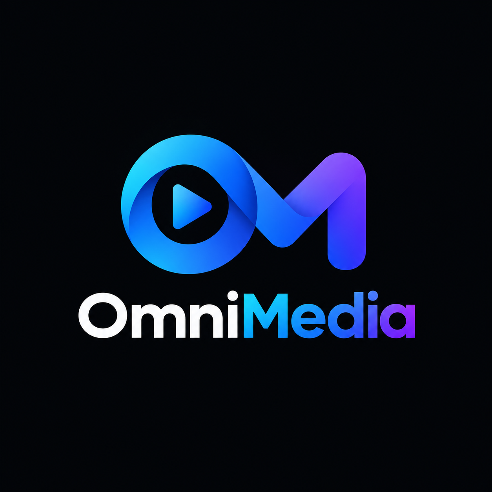
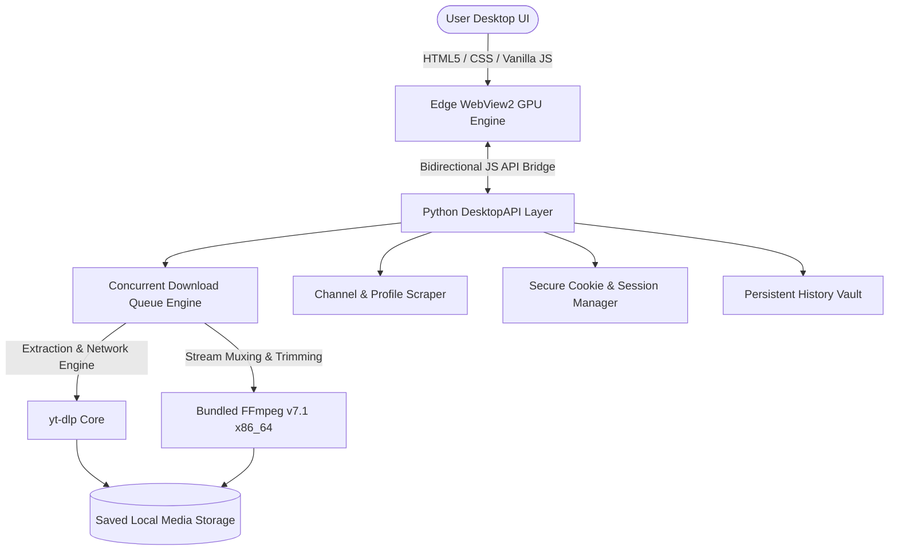

<div align="center">

  

  # ⚡ OmniMedia Pro
  ### The Ultimate Open-Source Multi-Platform Media Suite
  **High-Speed Bulk & Single Media Downloader with Glassmorphic Desktop Experience**

  <p align="center">
    <a href="https://github.com/Eaminx/OmniMedia-Open-Source-Video-Dowloader-Youtube-Facebook-Instagram-Tiktok-/releases/latest">
      
    </a>
    
    
    
    
    
  </p>

  <p align="center">
    <a href="#-quick-download">🚀 Quick Download</a> •
    <a href="#-platform-matrix">🌐 Supported Platforms</a> •
    <a href="#-key-features">✨ Key Features</a> •
    <a href="#-architecture">🏗️ Architecture</a> •
    <a href="#-run-from-source">💻 Run from Source</a> •
    <a href="#-build-standalone-exe">🔨 Build EXE</a>
  </p>

</div>

---

> **OmniMedia Pro** is an open-source, hardware-accelerated desktop utility built for content creators, archivists, and power users. Designed with modern Vercel/Discord-inspired Obsidian glassmorphism, it allows seamless single, batch, and full-channel scraping with zero ads, zero tracking, and bundled FFmpeg v7.1.

---

## 🚀 Quick Download

No Python, FFmpeg, or dependencies required! Download the pre-compiled, fully self-contained portable executable:

| Release | Platform | Format | Size | Link |
| :--- | :--- | :--- | :--- | :--- |
| **OmniMedia Pro v1.0.0** | Windows 10 & 11 (64-bit) | Standalone `.exe` | ~91.5 MB | [**Download OmniMedia_Pro.exe**](https://github.com/Eaminx/OmniMedia-Open-Source-Video-Dowloader-Youtube-Facebook-Instagram-Tiktok-/releases/latest) |

*Simply download and double-click to run. Everything (Python runtime, WebView2 bridge, yt-dlp, FFmpeg binaries, and UI assets) is packed into this single file.*

---

## 🌐 Platform Matrix

| Platform | Videos | Shorts / Reels | Playlists / Feeds | Audio Extraction | Max Resolution |
| :--- | :---: | :---: | :---: | :---: | :---: |
| **YouTube** | ✅ Full Support | ✅ Full Support | ✅ Full Channel & Playlists | Lossless MP3, FLAC, WAV, AAC, M4A | Up to 8K 60FPS HDR |
| **TikTok** | ✅ No Watermark | ✅ Full Support | ✅ Profile Scraper | Lossless MP3, AAC | Highest Available |
| **Instagram** | ✅ Reels & Videos | ✅ Stories & Posts | ✅ Profile Media | Lossless MP3, AAC | 1080p Full HD |
| **Facebook** | ✅ Public Videos | ✅ Facebook Reels | ✅ Watch Feeds | Lossless MP3, AAC | Up to 1080p/2K HD |

---

## ✨ Key Superpowers

### 🎨 1. Fluid Hardware-Accelerated UI
- Built on top of Microsoft Edge **WebView2 (Evergreen Runtime)** with GPU compositing.
- 60+ FPS fluid animations, deep obsidian theme, custom scrollbars, and tactile responsive controls.
- **Neon Double-Ring Startup Spinner**: Zero black screen during engine warm-up.
- **Adaptive Resolution**: Default form size optimized to **1084 x 664 px** with responsive layout.

### 📋 2. Smart Clipboard URL Sniffer
- Auto-detects media URLs copied to Windows clipboard from YouTube, TikTok, Instagram, and Facebook.
- Non-intrusive floating banner offers instant **"Preview & Inspect"** or **"Quick Add to Queue"** without manual pasting.

### ✂️ 3. Keyframe-Accurate Video Section Trimmer
- Download only the specific segment you need from multi-hour podcasts or concerts (e.g. `02:15` to `08:40`).
- Direct stream slicing saves bandwidth and time without downloading full oversized video files.

### 📺 4. Channel & Profile Bulk Scraper
- Enter any channel handle (`@ChannelName`) or profile URL to scrape hundreds of videos in seconds.
- Interactive filtering tabs: **Videos Only**, **Shorts Only**, or **Both**.
- Batch cherry-picking: `Select All`, `Deselect All`, or multi-select with instant duplicate detection.

### 📁 5. Smart Channel & Creator Sub-Folders
- Automatically routes downloaded videos into dedicated folders named after the creator (e.g., `Downloads/OmniMedia_Downloads/CreatorName/`).
- Keeps your local hard drive organized without manual sorting.

### ⚡ 6. Auto-Shutdown PC on Queue Completion
- Run massive overnight bulk queues without leaving your machine running indefinitely.
- Features a safe, cancelable 60-second animated countdown modal before initiating power down.

### 🗄️ 7. History Vault with Smart File Tracking
- Persistent history of all completed downloads saved in local AppData.
- **Direct Play Button**: Opens and plays downloaded video files immediately in your default Windows media player (VLC, Windows Media Player).
- **Explorer Highlight**: "Folder" button opens Windows Explorer with the specific file selected.
- **Dynamic File Existence Checker**: If a file was moved or deleted from disk, the button automatically transforms into a red disabled `Missing` state, blocking invalid clicks with an animated **`⚠️ File Moved or Deleted`** warning tooltip.

### 🎵 8. Hi-Res Lossless Audio Suite
- Extract pure audio tracks in **FLAC Lossless**, **WAV Uncompressed**, **Lossless MP3 320kbps**, **AAC 256k**, or **M4A**.

### 🔄 9. In-App 1-Click yt-dlp Engine Updater
- Easily update yt-dlp directly from Settings with one click when YouTube alters streaming algorithms.

### 🔐 10. In-App YouTube Login & Cookie Vault
- In-App Edge login window to unlock age-restricted, members-only, and 4K/8K 60FPS videos.
- Credentials and session cookies are securely isolated in `%LOCALAPPDATA%\OmniMediaPro_WebProfile\`, preventing accidental git or archive leaks.

---

## 🏗️ Architecture



---

## 💻 Run from Source

### Prerequisites
- Windows 10 or 11
- Python 3.10 or higher
- Git

### 1. Clone the Repository
```bash
git clone https://github.com/Eaminx/OmniMedia-Open-Source-Video-Dowloader-Youtube-Facebook-Instagram-Tiktok-.git
cd OmniMedia-Open-Source-Video-Dowloader-Youtube-Facebook-Instagram-Tiktok-
```

### 2. Install Dependencies
```bash
pip install -r requirements.txt
```

### 3. Launch the Application
```bash
python main.py
```
*Or simply double-click **`run.bat`**.*

---

## 🔨 Build Standalone `.exe`

To package the entire application into a single, portable Windows `.exe` that bundles Python, WebView2 integration, yt-dlp, FFmpeg binaries, and all web assets:

```bash
python build_exe.py
```
*Or double-click **`build.bat`**.*

The output executable will be generated at:
```plaintext
dist/OmniMedia_Pro.exe   (~91.5 MB)
```

---

## 📁 Repository Structure

```plaintext
OmniMedia-Pro/
├── assets/                  # Original brand assets and multi-res Windows icon
│   ├── app.ico
│   ├── Elogo.png
│   └── OmniMedia.png
├── web/                     # Production Web UI (Discord/Vercel aesthetic)
│   ├── index.html           # Main shell markup & splash screens
│   ├── index.css            # Dark glassmorphic design system
│   └── app.js               # Reactive frontend controller & bridge
├── api.py                   # Python-JavaScript Desktop API bridge
├── build_exe.py             # Automated PyInstaller 1-file build script
├── build.bat                # 1-Click build shortcut
├── channel_scanner.py       # Channel, profile, and feed parser
├── cookie_manager.py        # Secure session cookie isolation
├── downloader.py            # Multi-threaded download manager & History
├── main.py                  # PyWebView window launcher & profile setup
├── requirements.txt         # Pip dependency manifest
├── run.bat                  # 1-Click developer launcher
└── README.md                # Comprehensive documentation
```

---

## 🤝 Contributing

Contributions, feature requests, and issue reports are welcome!
1. Fork the Project
2. Create your Feature Branch (`git checkout -b feature/AmazingFeature`)
3. Commit your Changes (`git commit -m 'Add some AmazingFeature'`)
4. Push to the Branch (`git push origin feature/AmazingFeature`)
5. Open a Pull Request

---

## 📄 License

Distributed under the **MIT License**. See `LICENSE` for more information.

---

<div align="center">
  <sub>Crafted with ❤️ by <a href="https://github.com/Eaminx"><b>Eaminx</b></a>. Powered by yt-dlp, FFmpeg, and PyWebView.</sub>
</div>
